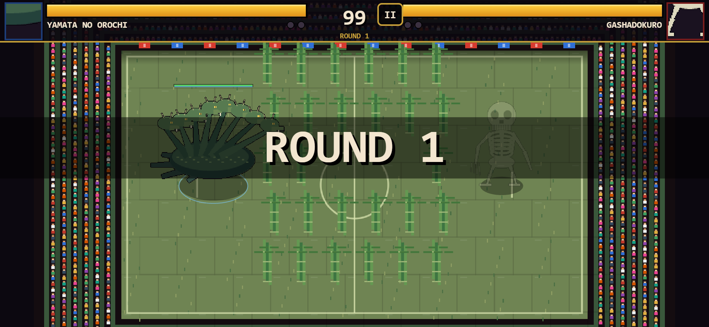

# YO-KA-MURAI

A mobile-first pixel arena brawler: four warriors versus five yokai.

**Play:** https://ty-robb.github.io/yo-ka-murai/

On iPad or phone, open the play link and choose **Share ? Add to Home Screen**.

## Controls

| Action | Touch | Keyboard |
|---|---|---|
| Move and face | Floating left joystick | WASD / arrows |
| Primary / secondary attack | Right buttons | J / K |
| Special | Large right button | L / Space |
| Pause | II | Escape |

Hold basic attacks to repeat. Hold and release Suzume's special to charge, Gashadokuro's to aim the rising hand, and Orochi's to steer underground.

## Play

Duel vs AI supports Easy, Normal and Hard, a chosen or random opponent, best of three rounds and four randomly selected arenas.

For online duels, **Create Lobby** and share the four-letter code. Your opponent chooses **Join Lobby**. Choose fighters and both press **Ready**. Both players must request a rematch. Online matches keep running while the pause menu is open.

Online uses PeerJS/WebRTC and the public PeerJS signaling server. Internet access is required. Some restrictive networks prevent direct peer connections; try a different network if a connection times out.

## Fighters

Warriors: Itsube (katana), Hayate (kusarigama), Suzume (yumi), Okuma (war scythe).

Yokai: Kodama, Kappa, Akaoni, Gashadokuro and Yamata no Orochi.

All nine fighters are unlocked. Arenas: Dojo, Mountain, Shogun's Palace and Bamboo Field. Breakable cover and craters persist between rounds. Mountain cliff ring-outs cost 25% max HP; the palace pond slows fighters except Kappa; bridges cross the pond; bamboo blocks sight until cut.

## Development

Plain HTML5 canvas and JavaScript, no build step. Fighter stats are in js/data.js, special handlers in js/abilities.js, and arena definitions in js/arenas.js. Online is host authoritative; guests send inputs and receive render snapshots.

Run with Node 22 or newer:

    node tools/serve.js 8795
    node tools/verify-sim.js
    node tools/verify-render.js
    node tools/verify-online.js

The render and online checks use installed Microsoft Edge headlessly and the local server. Online checks require access to PeerJS's public server.

PeerJS 1.5.5 is vendored under the MIT license; see assets/vendor/peerjs-LICENSE.
